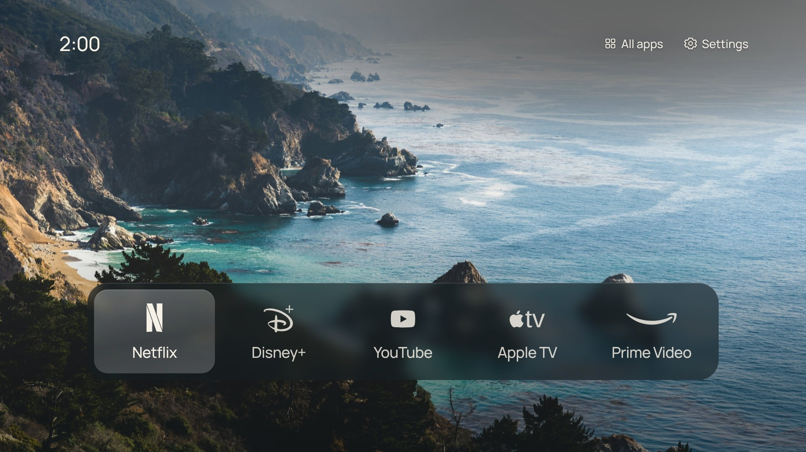

# CleanFrame auf LG-Fernsehern (webOS)

Dieser Fork bringt CleanFrame auf LG-Fernseher mit webOS. Oberfläche, Einstellungen und Bedienung mit der Fernbedienung sind dieselben wie beim Samsung-Original. Nur die Anbindung an den Fernseher ist neu.



**Stand:** Der LG-Adapter ist im Browser mit einem nachgebauten webOS-Dienst getestet (`npm run check:webos`). Auf einem echten LG-Fernseher ist er noch **nicht** ausprobiert worden. Rechne damit, dass beim ersten Test auf dem Gerät noch Kleinigkeiten anzupassen sind.

**Zielgerät:** LG 43UA73006LA (UHD-LED, 2025), webOS 25 / 10.3.2-34, knapp 1 GB interner Speicher, davon etwa 0,38 GB frei. Das Paket ist rund 16 MB groß.

## Was anders ist als bei Samsung

| Bereich | Samsung (Tizen) | LG (webOS) |
| --- | --- | --- |
| TV-Anbindung | `app/device.js` | `app/device-webos.js`, übernimmt automatisch, wenn keine Tizen-API da ist |
| App-Beschreibung | `app/config.xml` | `webos/appinfo.json` |
| Paket | `.wgt`, signiert mit Samsung-Zertifikat | `.ipk`, gebaut mit dem offiziellen LG-Werkzeug `ares-package` |
| Art Mode | vorhanden | entfällt, der Knopf wird ausgeblendet |
| „Samsung Home" | Samsung-Startseite | „LG Home" (`com.webos.app.home`) und LG-Einstellungen |
| Installierte Apps finden | vollständige Liste | siehe unten |

Die Zurück-Taste der LG-Fernbedienung (Code 461) kommt bei CleanFrame an, weil `disableBackHistoryAPI` gesetzt ist. Ein Druck auf Zurück auf der Startseite fragt deshalb, ob LG Home geöffnet werden soll. Die Magic-Remote-Maus funktioniert ebenfalls, weil alle Elemente anklickbar sind.

### Installierte Apps

webOS lässt selbst installierte Apps im Entwicklermodus die Liste aller Apps nicht lesen; das geht nur auf gerooteten Fernsehern. CleanFrame fragt deshalb für eine Liste bekannter Apps einzeln nach, ob sie installiert sind, und zeigt nur die vorhandenen. Eine App, die nicht innerhalb von 2,5 Sekunden antwortet, gilt als nicht installiert. Die Liste steht in `KNOWN` in `app/device-webos.js` und enthält unter anderem Netflix, YouTube, Disney+, Prime Video, Apple TV, Max, Spotify, Plex, Jellyfin, Live TV, HDMI 1–4 und den Browser. Apps wie MagentaTV, Joyn, ARD oder ZDF fehlen noch, weil ihre LG-App-IDs nicht bekannt sind.

**Eigene Apps ergänzen:** Starte die gewünschte App auf dem Fernseher und führe dann aus:

```bat
npm run lg:running
```

Die angezeigte ID trägst du als Paar `['app-id', 'Name']` in `KNOWN` ein.

Die Standard-Apps auf der Startseite sind Netflix, Disney+, YouTube, Apple TV und Prime Video. Prime Video wird zuerst als `amazon` gestartet und nur, wenn diese App fehlt, als älteres deutsches `lovefilm.de`.

## Voraussetzungen

- LG-Fernseher mit **webOS 22 oder neuer** (Modelle ab 2022). Ältere Versionen nutzen einen zu alten Browser; Abstände in der Oberfläche wären dort falsch.
- Ein Windows-PC im **selben Netzwerk** wie der Fernseher, ohne Gäste-WLAN und ohne VPN. Auf Mac und Linux funktionieren dieselben Befehle.
- Ein kostenloses Konto bei [LG Developer](https://webostv.developer.lge.com/).

## 1. Programme auf dem PC installieren (einmalig)

In dieser Reihenfolge:

1. **Node.js** in der LTS-Version (22 oder neuer) von [nodejs.org](https://nodejs.org/) herunterladen und mit den Standard-Einstellungen installieren.
2. **Python 3** von [python.org](https://www.python.org/downloads/) installieren. Im ersten Fenster des Installers unbedingt **„Add python.exe to PATH“** ankreuzen.
3. Den **Code** herunterladen: [CleanFrame als ZIP](https://github.com/LuisStyle2359/CleanFrame/archive/refs/heads/ccr-24a8de1f-nn26ot.zip). Die ZIP-Datei entpacken, zum Beispiel nach `C:\CleanFrame`.

Öffne dann die **Eingabeaufforderung**: Windows-Taste drücken, `cmd` tippen, Enter. Nimm nicht PowerShell; dort blockiert Windows die `npm`-Befehle standardmäßig. Prüfe die Installation und wechsle in den CleanFrame-Ordner:

```bat
node -v
py --version
cd C:\CleanFrame
npm ci
```

`node -v` muss `v22` oder höher zeigen, `py --version` eine `Python 3`-Version. Den Ordnernamen nach `cd` passt du an, falls du woanders entpackt hast; der Ordner muss die Datei `package.json` enthalten. Alle weiteren Befehle führst du in diesem Ordner aus.

## 2. Im Browser ausprobieren (optional)

```bat
npm run dev:public
```

Öffne <http://localhost:4795/home/>. Die Vorschau zeigt die LG-Fassung. Apps starten dort nicht; das geht nur auf dem Fernseher. Beenden mit Strg+C.

## 3. Entwicklermodus auf dem Fernseher

1. Im LG Content Store die App **Developer Mode** installieren, öffnen und mit deinem LG-Developer-Konto anmelden.
2. **Dev Mode Status** einschalten. Der Fernseher startet neu.
3. Die Developer-Mode-App erneut öffnen und **Key Server** einschalten.
4. Die angezeigte **IP-Adresse** und die **Passphrase** notieren.

Die Entwicklermodus-Sitzung ist begrenzt. Auf dem Zielgerät (webOS 25) startet sie mit 999 Stunden, also rund 41 Tagen; ältere Angaben von LG nennen 50 Stunden. Läuft sie ab, entfernt der Fernseher selbst installierte Apps wieder. Prüfe deshalb die verbleibende Zeit in der Developer-Mode-App und verlängere die Sitzung dort rechtzeitig.

## 4. Fernseher mit dem PC verbinden (einmalig)

Ersetze `192.168.0.42` durch die IP-Adresse aus der Developer-Mode-App:

```bat
npm run lg:setup -- 192.168.0.42
npm run lg:key
npm run lg:info
```

- `lg:setup` trägt den Fernseher unter dem Namen `tv` ein. Ändert sich später die IP-Adresse, führst du den Befehl einfach mit der neuen Adresse erneut aus.
- `lg:key` fragt nach der Passphrase. Tippe sie ein und drücke Enter.
- `lg:info` zeigt bei Erfolg Modell und webOS-Version deines Fernsehers.

Beim ersten Mal lädt `npx` das LG-Werkzeug herunter; das dauert etwas. Fragt Windows, ob `node.exe` ins Netzwerk darf, erlaube es für private Netzwerke.

## 5. CleanFrame installieren und starten

Baue das Paket und installiere es:

```bat
npm run package:webos
npm run lg:install
npm run lg:launch
```

`package:webos` erzeugt `dist\io.github.luisstyle2359.cleanframe_<version>_all.ipk`. Alternativ baut GitHub das Paket bei jedem Push: Im Repository unter **Actions** den neuesten Lauf von **Check** öffnen, unter **Artifacts** `CleanFrame-LG` herunterladen, entpacken und die `.ipk`-Datei in den Ordner `dist` legen. Danach genügen `lg:install` und `lg:launch`.

CleanFrame erscheint anschließend auch in der normalen LG-App-Leiste.

## Wenn etwas nicht klappt

| Meldung | Lösung |
| --- | --- |
| „…kann nicht geladen werden, da die Ausführung von Skripts … deaktiviert ist" | Du bist in PowerShell. Nimm die Eingabeaufforderung (`cmd`). |
| „Python 3 was not found" oder „Python wurde nicht gefunden" | Python neu installieren, „Add python.exe to PATH" ankreuzen, dann ein neues `cmd`-Fenster öffnen. |
| „Connection timed out" | Ist der Entwicklermodus noch aktiv? Sind PC und Fernseher im selben Netz? Hat sich die IP-Adresse geändert? Dann `npm run lg:setup -- <neue IP>`. |
| CleanFrame ist vom Fernseher verschwunden | Die Entwicklermodus-Sitzung ist abgelaufen. In der Developer-Mode-App die Sitzung erneuern und `npm run lg:install` wiederholen. |
| In CleanFrame steht „This TV does not let CleanFrame read its installed apps." | webOS verweigert die App-Abfrage. Apps auf der Startseite lassen sich trotzdem starten; melde den Fall bitte. |

Heißt dein Gerät nicht `tv`, setze vor den Befehlen in `cmd` einmal `set LG_DEVICE=<name>`.

## Home-Taste und Start beim Einschalten

Ohne Root lässt sich die Home-Taste der LG-Fernbedienung **nicht** auf CleanFrame umlegen, und CleanFrame startet nicht automatisch beim Einschalten. Praktische Wege:

- CleanFrame in der LG-App-Leiste ganz nach vorn schieben.
- Auf gerooteten Fernsehern (Homebrew Channel) kann das Homebrew-Werkzeug *Input Hook* eine Taste auf die App-ID `io.github.luisstyle2359.cleanframe` legen. Root ist ein Eingriff auf eigenes Risiko und nicht Teil dieses Projekts.

## App-ID ändern

Die App-ID steht in `webos/appinfo.json` und als `SELF` in `app/device-webos.js`. Ändere beide gemeinsam; `npm run check` prüft, dass sie übereinstimmen, und die Tests lesen sie aus `appinfo.json`. IDs, die mit `com.webos.`, `com.lge.` oder `com.palm.` beginnen, gehören LG und werden abgelehnt.

## Prüfen

```sh
npm run check
npm run check:browser                             # Samsung-Pfad (Mac/Linux: CLEANFRAME_PUBLIC_FONTS=1 davor)
npm run check:webos                               # LG-Pfad, ohne Fernseher
```

## Offene Punkte

- Auf echter LG-Hardware testen: Start von Apps, LG Home, Zurück-Taste, Darstellung und Tempo der Glas-Effekte.
- Ob `getAppLoadStatus` auf webOS 25 erlaubt ist, ist nur aus anderen Projekten bekannt ([webos-launcher](https://github.com/partridgeworks/webos-launcher) auf webOS 6, free-my-tv auf neueren Versionen).
- `ares-package` warnt, dass `requiredACG` in `appinfo.json` fehlt. Bis webOS 25 wird diese Angabe nicht ausgewertet. Trage **kein** leeres `"requiredACG": []` ein: Ab webOS 26 würde das die Systemaufrufe sperren, die CleanFrame braucht. Vor einem Update auf webOS 26 müssen die richtigen Gruppen-Namen aus LGs ACG-Anleitung ergänzt werden.
- Die Listen-Ansicht mit Foto belegt mehr Grafikspeicher als das Dock. Ob webOS CleanFrame auf dem Einstiegsmodell deshalb im Hintergrund schließt, zeigt erst der Test.
